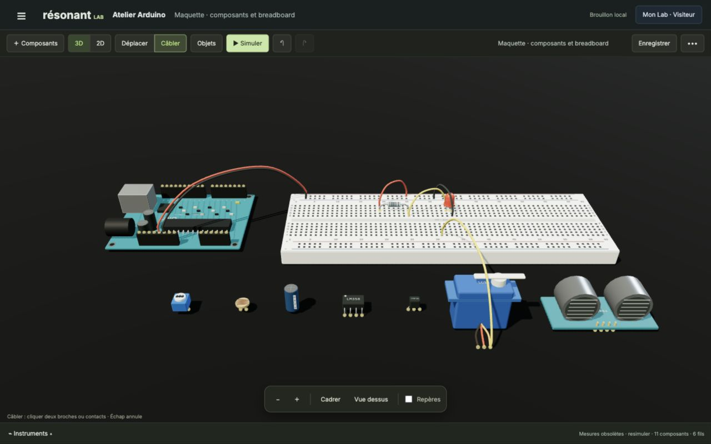

# Maquette physique, catalogue et câblage par double-clic

Livraison locale des 3–4 novembre 2026. Complète la [refonte des espaces](REFONTE_ATELIER_2026-11-03.md). Aucun déploiement, push, changement de service, secret, compte ou base de production. La mission générale atelier/Arduino reste en cours.

> La [livraison du 5 novembre](SCHEMA_LIE_2026-11-05.md) remplace les cartes 2D par des symboles électriques et ajoute le parcours schéma → implantation liée. Les capacités numériques et limites de composants décrites ci-dessous restent applicables.

## Résultat utilisable

L’atelier propose maintenant **29 familles de composants**, une recherche et un filtre par catégorie. Le montage reste indépendant d’un import audio. Les composants possèdent des broches identifiées, un symbole, une géométrie originale et une indication explicite des capacités de simulation.

La scène 3D a été reconstruite avec des géométries propres au projet : breadboard 830 contacts numérotés, rails, fente centrale et trous instanciés ; PCB Uno, connecteurs, USB, alimentation, composants traversants et inscriptions ; pattes, bagues de résistance, polarités, boutons et boîtiers de capteurs. Teensy et Audio Shield restent des représentations d’implantation illustratives. Les dimensions/empreintes pédagogiques ne remplacent pas la vérification de la variante achetée.

La référence Tinkered a été observée dans le projet connecté montré par l’utilisateur : scène dominante, composants identifiables, sélection compacte et configuration à la demande. Aucune ressource, texture, modèle ou portion de code du service n’a été copié. Ce travail ne revendique pas une équivalence complète avec ce service.

Manipulations :

- Glisser directement une pièce pour la déplacer, sans Maj ; glisser le fond pour tourner, bouton droit pour déplacer la caméra. Alt permet le placement libre sans accrochage de grille.
- Un clic sélectionne et ouvre une petite barre : valeur, rotation, configuration, duplication, suppression. La configuration est un panneau compact et scrollable, fermé au départ.
- « Centrer la pièce », « Cadrer », vue de dessus, zoom et repères permettent d’inspecter les petites pièces.
- **Double-cliquer une broche ou un trou démarre un câble**, même en mode Déplacer. L’aperçu suit le pointeur. Cliquer une seconde broche termine la liaison ; Échap annule et revient au déplacement. Le mode Câbler conserve le parcours par clics. En 2D, une broche est également utilisable au clavier avec Entrée.
- Un câble provisoire ne modifie ni le projet enregistré ni la netlist. Une même broche ne peut pas être ses deux extrémités ; une liaison identique, même inversée, est refusée. Les gestes différés sont nettoyés au démontage/changement de mode ; le double-clic natif annule le clic différé en attente.
- Les deux vues partagent composants, valeurs et liaisons, avec des coordonnées d’affichage distinctes. Les fils peuvent être sélectionnés, colorés, réglés en hauteur et supprimés. Annuler/rétablir couvre les modifications du montage.



Cette capture est une démonstration d’implantation de composants : elle ne prouve pas l’exécution du programme Uno ni la simulation du servo/capteur numérique.

## Catalogue : capacités réelles

| Pièces | Statut et calcul |
|---|---|
| Résistance, condensateur film, alimentation DC/échelon, masse | Modèles électriques idéaux, ngspice local. |
| Potentiomètre, électrolytique, inductance | Modèles simplifiés : deux résistances + contact de curseur ; C idéal polarisé visuellement ; L linéaire avec résistance série. |
| LED, diode 1N4148, NPN 2N3904, MOSFET BS170 | Modèles SPICE pédagogiques, sans calibration fabricant ni garantie de comportement thermique/réel. |
| Bouton 4 pattes, inverseur SPDT | Continuités internes et résistances de contacts ; position constante pour chaque acquisition. |
| LDR, NTC, TMP36 | Lois analogiques explicites et paramètres éditables ; pas de dynamique thermique/optique. |
| LM358 DIP-8 | Double amplificateur pédagogique alimenté, gain et saturation ; pas de bande passante, slew rate, courant ou offset réalistes. |
| Breadboards 10 colonnes / 830 contacts, connecteur 1×4 | Connectivité uniquement. |
| Uno, Teensy 4.1, Audio Shield | Visuels, non émulés ; bloquent une demande de simulation de leur projet. |
| Buzzer, HC-SR04, DHT22, OLED SSD1306, SG90, moteur DC | Implantation et câblage seulement ; protocoles, mécanique et acoustique non simulés. Le solveur refuse explicitement ces montages. |

Les définitions sont extensibles dans `componentExtras.ts`, avec broches ordonnées, paramètres, unités, modèle, catégorie, limites, référence et lien documentaire lorsqu’il est disponible. Ce n’est pas « tous les composants existants ». Un composant visuel n’acquiert aucune capacité électrique par sa seule présence en 3D. Les modèles custom, imports de ressources 3D ou SPICE arbitraires ne sont pas ajoutés dans ce lot.

Lois importantes :

- Potentiomètre : deux résistances complémentaires, contact de curseur 1 Ω, position 0–1.
- LDR : `R10 × (lux / 10)^(-γ)`, bornée à 100 Ω–10 MΩ ; paramètres à identifier sur le composant réel.
- NTC : `R25 × exp[β × (1/T − 1/298,15)]`, T en kelvins.
- TMP36 : `0,5 + 0,01 × température_en_°C`, sortie bornée par les rails. Alimentation recommandée 2,7–5,5 V.
- LM358 : gain 100000, sortie bornée entre V− et V+−1,5 V, résistance de sortie 10 Ω. C’est une approximation déclarée, pas un macro-modèle fabricant.

## Une implantation réellement reliée au circuit

Le projet commun conserve `mount.board` et le contact de chaque patte. L’insertion explicite vérifie empreinte, écartement, limites et trous occupés. Déplacer un composant enfiché le retire des contacts avec un message ; Annuler le remet. Déplacer/tourner la platine conserve les contacts de ses composants.

La breadboard 830 comporte 63 colonnes A–E et F–J, deux groupes séparés par colonne et quatre rails de 50 contacts. Le réglage de coupure au milieu distingue les segments 25+25. Le pas est 2,54 mm ; le DIP-8 utilise l’écartement central 7,62 mm et n’est accepté que sur E/F. Poser visuellement une pièce au-dessus d’un trou ne crée pas de contact.

Les exemples diviseur, RC et LED sont enfichés et utilisent réellement les groupes de contacts. Quatre exemples supplémentaires sont accessibles : potentiomètre, TMP36, LDR et bouton avec résistance de rappel. Les courbes proviennent de ngspice, pas d’une animation indépendante.

Les calculs restent dans le Worker WebAssembly local existant : pas de calcul serveur, Drive, Gemini ni API d’IA. Limites conservées : 48 pièces, 200 fils, 24 réseaux mesurés, acquisition 1 µs–100 ms, timeout de 15 s, nombre de points borné. Aucune tolérance DSP modifiée. Arrêt/erreur termine le Worker ; une mesure est liée à sa révision et marquée obsolète après édition.

## Passerelle TIPE et nomenclature

L’action audio conserve le **graphe sélectionné entier**, son instantané exact, le nom du WAV, la sélection, sa fréquence d’échantillonnage et un résumé d’analyse. Le dossier TIPE regroupe matériel, quantités, familles/références fabricant, câblage et couverture des blocs. Les composants génériques demandent encore le choix d’une référence exacte et la vérification de l’empreinte.

Une première conversion limitée est disponible : **étude d’un bloc `lowpass1` en RC passif**, R=1 kΩ et C choisi dans E12. À 3500 Hz demandés : C=47 nF, coupure nominale 3386,275 Hz, écart −3,249 %. Une plage illustrative R±1 % / C±5 % est présentée. Le patch entier est gardé ; seule cette cellule est étudiée. La réponse analogique et la réponse numérique bilinéaire ne sont pas identiques sur tout le spectre.

Le firmware existant extrait les modes du patch sélectionné sans revenir silencieusement aux seuls partiels d’analyse. Cela ne fournit toujours pas le portage intégral des filtres, saturations, bruit et enveloppes. La proposition Teensy + codec n’est ni un circuit complet validé ni une reproduction physique du piano. L’émulation Arduino, compilation, entrée ADC et moniteur série restent à implémenter.

## Vérifications exécutées

Machine de développement macOS arm64 ; navigateur Chromium intégré. Bases synthétiques temporaires sous `/tmp`, sans production. Commandes :

```bash
PYTHONPATH=backend .venv/bin/pytest backend/tests -q
node frontend/tests/run.mjs
npm run build --prefix frontend
```

- **142 tests backend réussis**, relancés le 4 novembre ; trois avertissements existants FastAPI/TestClient.
- **49 tests frontend réussis**, dont DSP/WAV, MIDI, transposition, Worker, validation/import, breadboard, nouveaux modèles électriques et câblage. Tests numériques exécutés avec le vrai ngspice WASM. Les tests de cycle de vie utilisent aussi un faux Worker, sans les présenter comme une mesure CPU réelle.
- TypeScript et build Vite réussis. Avertissement existant du port ngspice sur l’externalisation Node `module`. Le choix d’ombre Three.js déprécié a été remplacé par `PCFShadowMap` après observation de la console.

Tolérances fixées dans les tests avant validation des nouveaux modèles :

| Vérification | Tolérance / critère |
|---|---|
| Diviseur 1 kΩ / 1 kΩ | erreur < 1e-8 V par rapport à 2,5 V |
| Potentiomètre 0,25 / 0,75 / extrémités | erreur < 2e-6 V par rapport à 5×position |
| TMP36 −40 / 25 / 100 °C | erreur < 1e-7 V par rapport à 0,1 / 0,75 / 1,5 V |
| LDR / NTC | erreur < 1e-6 V sur les diviseurs testés |
| Bouton ouvert/fermé | erreur < 1e-6 V par rapport aux résistances déclarées |
| Réponses RC et RL | erreur < 0,005 V au temps caractéristique, interpolation de trace |
| Suiveur LM358 pédagogique à 1,2 V | erreur < 1e-4 V |
| Diode / transistors | tests de polarité et de commutation, pas de calibration fabricant |
| Parité DSP déterministe et transposition | tolérances existantes conservées ; ne concerne pas des bruits NumPy/JS différents |

Recette navigateur effectuée :

- Potentiomètre à 0,5 : 2,5000 V ; passage à 0,25 : 1,2500 V, dans le vrai Worker navigateur. Sauvegarde du réglage effectuée.
- TMP36 à 25 °C : 0,75000 V. Courbe réelle et révision affichées.
- Double-clic en 2D : apparition du brouillon, second contact : passage de quatre à cinq fils seulement ; Annuler retire le fil.
- Double-clic sur le trou g52 en 3D : origine identifiée ; second contact j59 : ajout d’un seul fil. Annulation et retour au déplacement testés.
- Échap depuis un bouton de broche 2D testé après correction de l’écoute clavier en capture ; aucun brouillon conservé.
- Déplacement direct de l’Uno sans Maj, aperçu, sélection compacte, fermeture des propriétés, inspection rapprochée du TMP36, ajout par catégorie et import du montage synthétique testés.
- Viewports 1280×800 et 390×844 ; à 390 px, largeur de document 390 px, panneau de propriétés de 290 px contenu dans l’écran. Il s’agit d’émulation de dimensions sur ordinateur, pas de tests sur téléphones physiques.
- La navigation de l’utilisateur n’a pas été automatisée pendant ses essais dans l’onglet d’analyse du piano. Un import `piano2.wav` et une analyse/génération locales avaient été exécutés le 3 novembre : 48 kHz, sélection 0–1 s, f0=438,99 Hz, 24 partiels, candidat 36 modes/80 modules. Ce test fonctionnel ne prouve ni une fidélité de 100 % ni la construction de son équivalent matériel.

Captures : `maquette-catalogue-3d.png`, `maquette-mobile.png`. Projets synthétiques, sans secrets. Le clavier MIDI physique a été manipulé par l’utilisateur ; aucun essai de clavier physique n’est revendiqué par l’agent.

## Fichiers principaux

- `circuitProject.ts`, `physicalLayout.ts` : validation du modèle, contacts et insertion physique.
- `componentExtras.ts`, `hardwareCatalog.ts` : catalogue, réglages, BOM, exemples et étude RC.
- `circuitEngine.ts` : compilation du sous-ensemble électrique autorisé pour ngspice.
- `electronics/partModels.ts`, `ComponentExtraGlyph.tsx`, `PartProperties.tsx` : géométries/icônes originales et propriétés compactes.
- `Project3D.tsx`, `Project2D.tsx`, `cableInteraction.ts` : manipulation, aperçu et gestes de câblage communs.
- `ArduinoWorkshop.tsx`, `App.tsx`, `LabShell.tsx`, `workspaces.css` : intégration, provenance et disposition.
- `frontend/tests/` et `frontend/dist/` : tests et build correspondant.

## Limites, licences et reprise

Aucune nouvelle dépendance installée dans ce lot. Three.js et React Flow déjà présents sont réutilisés, y compris leurs outils de lignes et de caméra. Les visuels sont originaux. **La provenance/licence de redistribution du binaire ngspice WASM tiers déjà présent demeure non résolue**, comme décrit dans la livraison du 3 novembre : wrapper avec LICENSE de remplacement et options KLU/FFTW du binaire non attestées. Un binaire reproductible et ses notices doivent être établis avant publication de cette dépendance. Aucune publication n’est faite ici.

Pas de benchmark avant/après reproductible de cette nouvelle scène : aucun gain chiffré de vitesse ou de mémoire n’est annoncé. Le rendu reste à la demande, sans boucle permanente au repos ; ombres invalidées lors d’une modification de géométrie, ressources disposées au démontage. Les nouveaux modèles doivent encore être validés sur appareils modestes et navigateurs physiques Android/iOS/Safari.

L’oscilloscope reste une acquisition transitoire par réseau vers la masse. Déclenchement, curseurs, sondes différentielles et analyse AC générique ne sont pas ajoutés. Les pièces numériques ne simulent pas de firmware. Le catalogue n’est pas une garantie de sécurité électrique ni une nomenclature finale de piano.

Prochain lot cohérent : cartes et compilation/exécution réellement isolées ; sonde/mesures améliorées ; modèles analogiques fabricant contrôlés et conversion de nouvelles cellules du graphe, avec comparaison numérique avant toute revendication de fidélité. Le portage de tout le DSP doit être évalué bloc par bloc, sans multiplication implicite de générateurs.

## Mise à jour et retour arrière

Aucun push automatique : le workflow `main` déclenche la production et la mission actuelle exige une autorisation de déploiement. Le commit de ce lot reste local.

Pas de migration SQLite. Exporter les projets JSON avant une mise à jour/retour arrière. Le format version 1 est étendu de façon additive ; les anciens fichiers restent lisibles par cette version, mais l’ancien code refusera les nouveaux types et pourra ignorer leurs paramètres. Ne pas réenregistrer un projet récent avec une vieille interface.

Pour une mise à jour autorisée : résoudre d’abord le point de licence du binaire, sauvegarder les artefacts/projets, exécuter les commandes de validation ci-dessus puis remplacer le build de façon atomique avec le backend compatible. Garder les anciens chunks pour les onglets déjà ouverts, ou annoncer le rechargement. Vérifier un exemple léger, import/enregistrement, 2D/3D, câblage, session et export. Pour revenir en arrière : restaurer un ensemble de fichiers/build cohérent, conserver les JSON récents, sans réinitialiser SQLite ni restaurer une ancienne base sur de nouvelles données.
