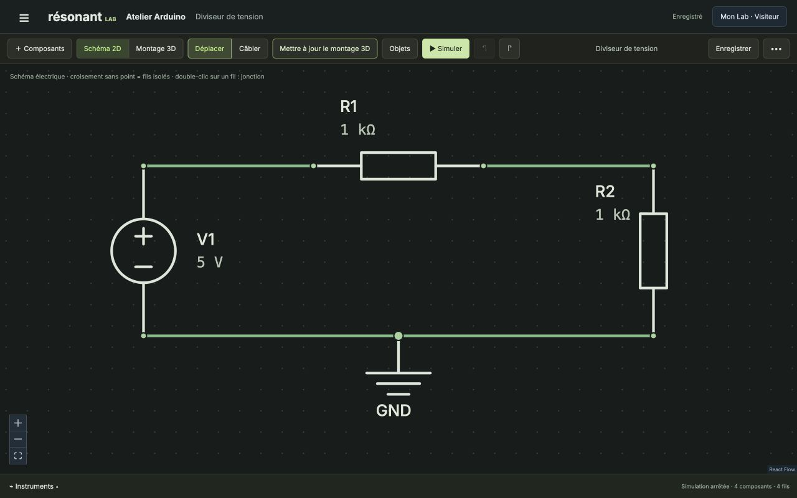
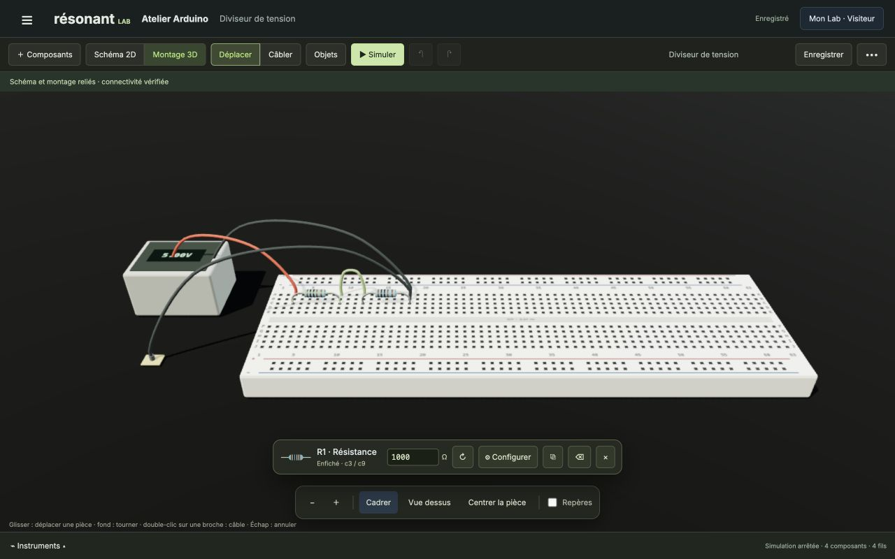

# Schéma électrique d’abord, implantation 3D liée

Livraison locale des 4–5 novembre 2026, après le commit `5ad153b`. Aucun push ni déploiement : `main` déclenche la production et l’autorisation de cette livraison reste locale. Aucun secret, service ou schéma SQLite de production modifié.

## Ce qui change

L’atelier démarre maintenant en **Schéma 2D**. Les cartes encadrées du précédent éditeur sont remplacées par des symboles électriques originaux : broches aux extrémités des symboles, repères R1/R2/C1…, valeurs lisibles, résistances, condensateurs, inductances, sources, masse, transistors, contacts et blocs intégrés. Les circuits simples ne montrent plus leurs centaines de contacts de breadboard dans le schéma.

La référence [Falstad Circuit Simulator](https://www.falstad.com/circuit/circuitjs.html) a été ouverte et observée : symboles sur fond sombre, liaisons rectilignes, jonctions et instruments séparés. L’implémentation utilise les bibliothèques déjà présentes et des SVG propres au projet ; aucun code, modèle ou ressource de CircuitJS n’a été incorporé. Ce n’est pas une intégration ni une équivalence complète avec Falstad.

Parcours :

1. Créer le schéma sans breadboard ni WAV, ajouter les composants depuis la bibliothèque.
2. Déplacer les symboles sur la grille, les tourner, régler leurs valeurs, relier leurs bornes et simuler localement.
3. Choisir **Créer le montage 3D**, examiner le nombre de platines/fils et les limites présentées, puis appliquer l’implantation.
4. Passer entre les deux vues pour modifier le même circuit. Une modification du câblage du schéma signale une implantation devenue obsolète ; la mise à jour est explicite et annulable.

Les outils restent contextuels. Le bouton de rotation agit sur l’orientation schématique en 2D et sur la pièce physique en 3D. Les positions 2D n’affectent pas l’implantation. La sélection conserve son identifiant en passant d’une vue à l’autre, et les repères des composants sont communs aux deux vues. Les repères automatiques suivent l’ordre des composants ; donner un nom explicite à une pièce permet de conserver un libellé personnalisé.

## Fils et jonctions

- Fils orthogonaux, choix d’un chemin parmi des tracés bornés et prise en compte des corps des symboles. Il ne s’agit pas d’un routeur planaire optimal ; les grands circuits peuvent encore demander une disposition manuelle.
- **Double-clic sur une borne** : début de câble ; clic sur une autre borne : fin ; Échap : annulation. Le brouillon n’est jamais une connexion enregistrée.
- **Double-clic sur un fil** : scission avec une jonction électrique explicite. Son nom permet de la sélectionner/déplacer et sa borne de raccorder une branche.
- Un croisement sans jonction reste isolé, même si des éléments sont posés exactement au même endroit. Aucun test de proximité ne crée de connexion.
- Au clavier, les bornes sont des boutons ; Entrée démarre/termine une liaison. Un fil peut être focalisé : Entrée le sélectionne et J ajoute une jonction sur un segment. La suppression reste accessible dans sa barre contextuelle.
- La commande **Ranger le schéma** est disponible dans les autres outils. Elle modifie uniquement l’affichage ; connexions, paramètres et implantation sont conservés.

Les traits verts sont un style de câblage, **pas une mesure de tension**. Aucune animation fictive de courant n’est ajoutée. Les mesures viennent du solveur existant. En vue 3D, le solveur reçoit le document physique lié, et non une autre copie du circuit. Une implantation obsolète a sa simulation désactivée et ses anciennes mesures effacées ; la vue 2D peut toujours simuler le schéma courant.

## Modèle commun et conversion

Le projet conserve les composants et connexions logiques comme circuit de référence. Le champ optionnel `assembly`, versionné, contient les platines, placements/pattes enfichées et fils physiques. Les valeurs, noms et réglages des composants sont résolus depuis le circuit courant ; une copie périmée des valeurs ne prend pas le dessus.

`circuitConnectivity.ts` calcule la partition électrique de toutes les broches métier, avec continuités de contacts, masses et boutons. La signature compare les identifiants/types des composants et l’appartenance de chaque broche à un réseau. La géométrie d’affichage est exclue.

La conversion :

- place les empreintes prises en charge sur une ou plusieurs platines 830 contacts ;
- respecte le pas, l’écartement des pattes, les trous occupés et la séparation centrale ;
- utilise des trous libres du même groupe pour les fils, sans enficher un fil dans un trou déjà occupé par une patte ;
- raccorde directement les petits réseaux lorsqu’un groupe de contacts suffit ; pour les grandes branches, ajoute des groupes de distribution reliés ;
- compare **toute la partition électrique avant et après** ; un court-circuit ou une connexion perdue refuse l’implantation ;
- conserve les limites de 48 éléments physiques et 200 fils, et échoue sans modifier le projet si la capacité ne suffit pas.

Le diviseur d’exemple utilise une seule platine, deux résistances enfichées et **quatre fils**. Cela ne démontre pas une implantation optimale pour tout circuit. Le placement ne vérifie pas toutes les collisions de boîtiers, la disponibilité commerciale, les courants ni le routage haute fréquence.

Un aperçu ancien ne peut pas écraser un schéma qui a changé entre-temps : il faut recalculer l’aperçu. Une modification physique du câblage met à jour les réseaux du schéma. Un simple déplacement libre conserve le câblage ; retirer des pattes de la platine modifie réellement les contacts, comme indiqué par l’interface. Les modifications électriques d’une implantation déjà obsolète sont bloquées jusqu’à sa mise à jour.

« Connectivité vérifiée » signifie que les deux représentations correspondent. Cela ne certifie ni un circuit fonctionnel, ni la sûreté de son assemblage, ni la fidélité d’un composant réel à son modèle simplifié.

## Compatibilité et sauvegarde

Les anciens montages sont extraits en schéma logique en conservant leur implantation précédente dans `assembly` : mêmes composants, paramètres, broches, placements et fils physiques. La migration se fait localement ; les fichiers JSON sources ne sont pas réécrits par la lecture. Les anciennes sauvegardes du navigateur restent conservées jusqu’à un enregistrement explicite, tandis que le brouillon suit les conventions existantes.

Le JSON version 1 est étendu de façon additive par `assembly.version=1`, `schematicRotation` et le type `junction`. Les imports valident également placements, références, tailles et champs inconnus. **Une ancienne interface ne sait pas conserver cette extension** et peut refuser les jonctions : ne pas réenregistrer un projet récent avec l’ancien code.

La nomenclature utilise l’implantation physique ; une jonction symbolique et une masse ne sont pas présentées comme des composants à acheter. La bibliothèque de 29 familles et ses statuts reste disponible, avec en plus l’outil de jonction. Les modèles numériques/visuels gardent les limites décrites dans la [livraison du catalogue](MAQUETTE_ET_CATALOGUE_2026-11-04.md).

## Validation exécutée

Commandes exécutées dans le dépôt :

```bash
PYTHONPATH=backend .venv/bin/pytest backend/tests -q
node frontend/tests/run.mjs
npm run build --prefix frontend
```

- **142 tests backend réussis** le 4 novembre, sans modification backend depuis cette exécution. Trois avertissements de dépréciation FastAPI/TestClient préexistants.
- **59 tests frontend réussis**, relancés le 5 novembre : les 49 tests précédents plus 10 tests de schéma, conversion, migration et précision.
- TypeScript et build Vite réussis. L’avertissement préexistant concernant la branche Node `module` du port ngspice reste affiché au build.

Les nouveaux tests vérifient :

| Contrôle | Critère vérifié |
|---|---|
| Sept circuits convertis | Diviseur, RC, LED, potentiomètre, TMP36, LDR, bouton : partitions électriques égales et tensions finales calculées par ngspice avant/après à moins de **1e-7 V**, mêmes paramètres. |
| RC converti | Réponse transitoire à τ=1 ms, écart < **0,005 V** par rapport à `5 × (1 − exp(−1))`, interpolation de trace. |
| Migration | Connexions et placements physiques conservés ; aller-retour JSON validé. |
| Liaison | Valeur modifiée répercutée au montage ; déplacement/rotation 2D sans changement de réseau ; modification de câblage et falsification d’une implantation détectées. |
| Édition physique | Déconnexion réelle répercutée au schéma, sans mutation de la source. |
| Jonction et croisements | Scission conservant les réseaux ; coordonnées identiques sans connexion implicite. |
| Branches nombreuses | Plusieurs platines, trous de fils uniques, aucun fil dans un trou occupé par une patte, absence de court-circuit implicite. |
| Imports et capacité | Broches inconnues, nombres non finis, rotations invalides et dépassement de capacité refusés ; échec atomique. |
| Symboles et rangement | Broches/rotations valides, segments orthogonaux, câblage et implantation inchangés après rangement, repères identiques en 2D/3D. |

Les tolérances DSP existantes ne sont pas modifiées. Ces essais numériques ne prouvent pas que les composants physiques sont identiques aux modèles idéaux/pédagogiques. Aucune identité bit à bit générale n’est revendiquée. Le test de liaison vérifie aussi le refus d’une simulation 3D sur une implantation obsolète, tout en conservant la simulation du schéma courant.

Recette navigateur : diviseur à 2,5000 V ; conversion avec deux résistances, une platine, quatre fils ; R2 passée à 2 kΩ dans le schéma, valeur retrouvée en 3D et mesure à 3,3333 V ; suppression d’un fil signalée comme implantation obsolète ; double-clic de création de câble et Échap ; ajout d’une jonction ; sauvegarde puis rechargement du circuit avec implantation vérifiée. Sélection de R1 conservée entre les deux vues et ajout d’une jonction par tabulation puis J réellement exécutés dans le navigateur.

Recette responsive effectuée dans le navigateur Chromium intégré sur ordinateur : **1280×800** et **390×844**. À 390 px, la largeur du document reste de 390 px et la scène mesure 390×610 px ; le panneau de conversion reste accessible. Ce ne sont pas des essais sur téléphone ou tablette physiques. Aucun message d’erreur ni avertissement n’a été relevé dans la console du nouvel onglet de recette pendant ces contrôles.

Captures de projets synthétiques, sans compte privé ni secret :





La capture mobile est conservée dans `screenshots/schema-electrique-mobile.png`.

## Fichiers et dépendances

- `schematicLayout.ts`, `SchematicSymbol.tsx`, `Project2D.tsx` : symboles originaux, grille, repères, rotation, câblage orthogonal, jonctions, interactions clavier.
- `circuitConnectivity.ts`, `schematicModel.ts` : réseaux, migration et implantation avec vérification d’équivalence.
- `circuitProject.ts` : validation/sérialisation du schéma et de son implantation ; résolution des valeurs actuelles dans la vue physique.
- `componentReference.ts`, `PartProperties.tsx`, `Project3D.tsx` : repères, sélection liée et propriétés communes.
- `ArduinoWorkshop.tsx`, `workspaces.css` : parcours en 2D d’abord, aperçu, état de liaison et ergonomie.
- `circuitEngine.ts`, `componentExtras.ts`, `hardwareCatalog.ts` : jonctions, labels de mesure et nomenclature.
- `frontend/tests/schematic.test.mjs`, `frontend/tests/run.mjs`, `frontend/dist/` : tests et build correspondant.

Aucune nouvelle dépendance installée, aucun appel IA ou serveur de calcul ajouté. Simulation ngspice, audio, WAV, analyse et génération locale conservent leurs moteurs. La licence/provenance du binaire ngspice tiers déjà présent reste à résoudre avant publication, comme documenté précédemment. Ce chantier n’implémente toujours pas la compilation/exécution Arduino, les protocoles des modules visuels ni un circuit reproduisant tout le piano.

## Mise à jour, retour arrière et suite

Aucune migration SQLite. Avant une mise à jour autorisée : résoudre la provenance du binaire, exporter les projets récents, conserver les anciens artefacts, exécuter les trois commandes de validation, puis remplacer backend/build de façon cohérente et atomique. Garder les anciens chunks pour les onglets ouverts ou annoncer leur rechargement. Vérifier session, schéma, exemple léger, conversion, sauvegarde et export ; ne pas lancer de charge en production.

Retour arrière : restaurer l’ensemble de code/build précédent, conserver les JSON récents séparément, sans réinitialiser les comptes ni restaurer une ancienne SQLite sur de nouvelles données. Les projets avec implantation liée/jonctions doivent être rouverts avec une version compatible.

Restent à développer séparément : routage manuel des coudes et jonction sur segment par simple branchement, placements de boîtiers plus contraints, routage global optimisé, sondes/instruments avancés, modèles fabricant validés et exécution de firmware. Aucun gain chiffré de performance ni essai sur téléphone physique n’est annoncé.
